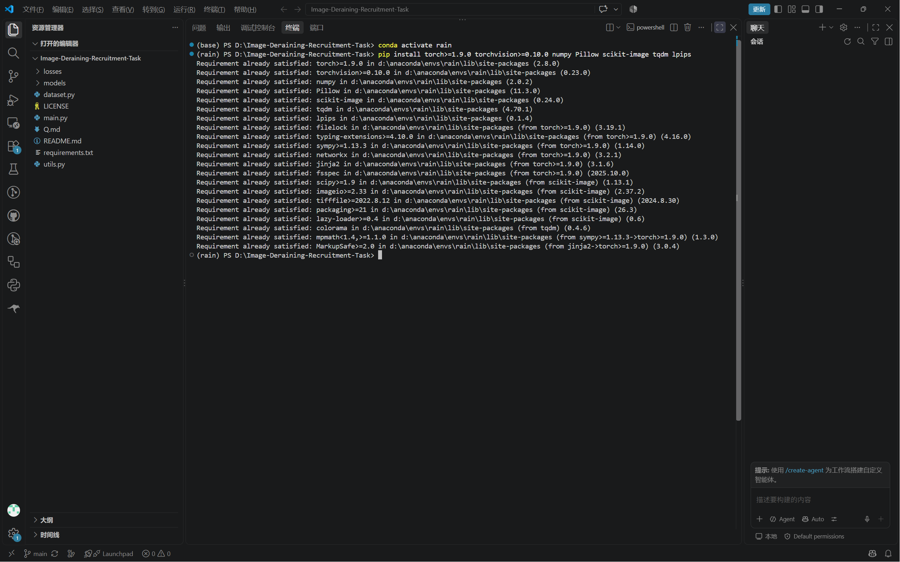

# Part1 - 任务三

**1.环境搭建：小菜一碟**

下图为安装依赖库的截图

**2.实现一个简单模型**

1. 下面是我的模型代码

```  python
import torch.nn as nn

class Block(nn.Module):
    def __init__(self, in_channels, out_channels, stride=1):
        super().__init__()
        self.conv1 = nn.Conv2d(in_channels, out_channels, kernel_size=3, stride=stride, padding=1)
        self.bn1 = nn.BatchNorm2d(out_channels)
        self.conv2 = nn.Conv2d(out_channels, out_channels, kernel_size=3, stride=1, padding=1)
        self.bn2 = nn.BatchNorm2d(out_channels)
        self.conv3 = nn.Conv2d(in_channels, out_channels, kernel_size=3, stride=stride, padding=1)
        self.bn3 = nn.BatchNorm2d(out_channels)
        self.conv4 = nn.Conv2d(out_channels, out_channels, kernel_size=3, stride=1, padding=1)
        self.bn4 = nn.BatchNorm2d(out_channels)
        self.conv5 = nn.Conv2d(in_channels, out_channels, kernel_size=3, stride=stride, padding=1)
        self.bn5 = nn.BatchNorm2d(out_channels)
        self.conv6 = nn.Conv2d(out_channels, out_channels, kernel_size=3, stride=1, padding=1)
        self.bn6 = nn.BatchNorm2d(out_channels)
        self.conv7 = nn.Conv2d(in_channels, out_channels, kernel_size=3, stride=stride, padding=1)
        self.bn7 = nn.BatchNorm2d(out_channels)
        self.conv8 = nn.Conv2d(out_channels, out_channels, kernel_size=3, stride=1, padding=1)
        self.bn8 = nn.BatchNorm2d(out_channels)

        self.shortcut = nn.Sequential()
        if stride != 1 or in_channels != out_channels:
            self.shortcut = nn.Sequential(
                nn.Conv2d(in_channels, out_channels, kernel_size=1, stride=stride),
                nn.BatchNorm2d(out_channels))

        self.relu = nn.ReLU()
            

    def forward(self, x):
        out = self.relu(self.bn1(self.conv1(x)))
        out = self.relu(self.bn2(self.conv2(out)))
        out = self.relu(self.bn3(self.conv3(out)))
        out = self.relu(self.bn4(self.conv4(out)))
        out = self.relu(self.bn5(self.conv5(out)))
        out = self.relu(self.bn6(self.conv6(out)))
        out = self.relu(self.bn7(self.conv7(out)))
        out = self.bn8(self.conv8(out))
        out += self.shortcut(x)
        out = self.relu(out)
        return out

class BaselineNet(nn.Module):
    def __init__(self):
        super().__init__()
        self.head = nn.Conv2d(3, 64, kernel_size=3, stride=1, padding=1)
        self.block = Block(64,64,stride=1)
        self.tail = nn.Conv2d(64, 3, kernel_size=3,stride=1,padding=1)

    def forward(self, x):
        out = self.head(x)
        out = self.block(out)
        out = self.tail(out)
        clean = x - out
        return clean
```

   2.如上图代码所示，在主路径之外**增加一个SkipConnetion（相当于一个捷径，不对数据进行处理）**，这样即使主路径的梯度接近0，SkipConnetion的恒等映射依然能返回梯度进行迭代。

**3.这个代码是什么意思？**

1.下图为训练结果

2.我学到的代码知识：

python命令行推荐使用Python 的 `argparse` 库

 `import argparse` 导入argparse模块

 `parser = argparse.ArgumentParser()`意思是**创建一个参数解析器对象**，命名为parser,ArgumentParser是模块中的一个类，专门用来创建解析器

`parser.add_argument("first_argument", help="this is the string text in connection with first_argument")`

`add_argument`是一个解析器方法，意思是添加一个参数

``"first_argument"``是参数名称，**这里没有写`--`是一个位置参数，意味着命令行中不需要把参数名写出来；如果加上`–-`则是一个可选参数，必须在命令行中写出参数名**

`help=“…”`表示当用户在命令行输入`--help`时会显示“…”中的帮助文本

`args = parser.parse_args()` 表示**调用对象**，parse_args是解析对象的方法，用来存储参数

默认情况下，argparse 将提供的选项**视为字符串**。因此，如果参数不是字符串，则应使用 `type` 选项。如`parser.add_argument("first_number", help="first number to be added", type=int)`

`args_dict = vars(parser.parse_args())`能够将参数存储在字典中，vars()是一个将Namespace对象存进字典的函数

在深度学习过程中，如果层数过多，可以通过**增加SkipConnection**来解决梯度消失的问题

