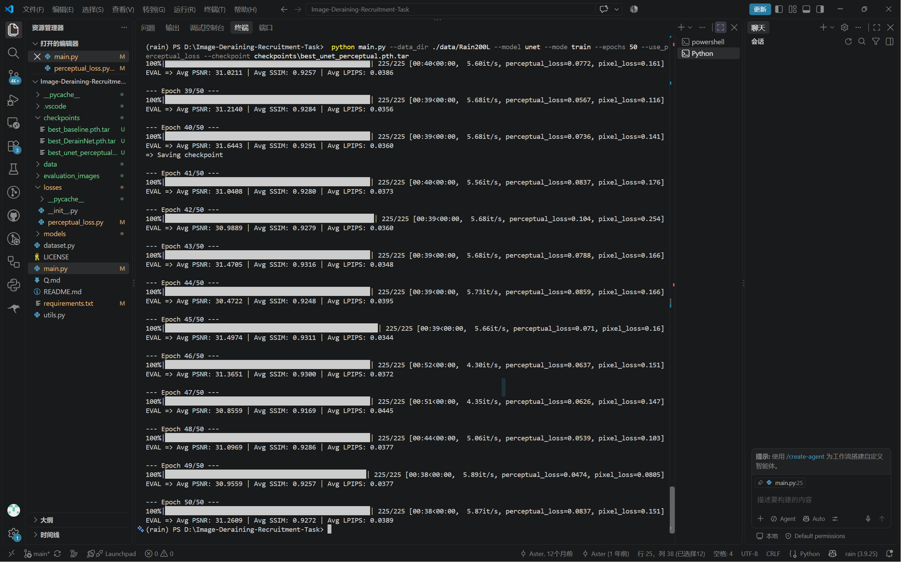
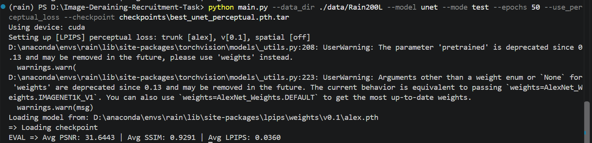
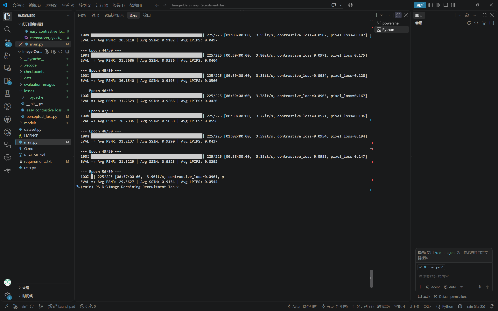
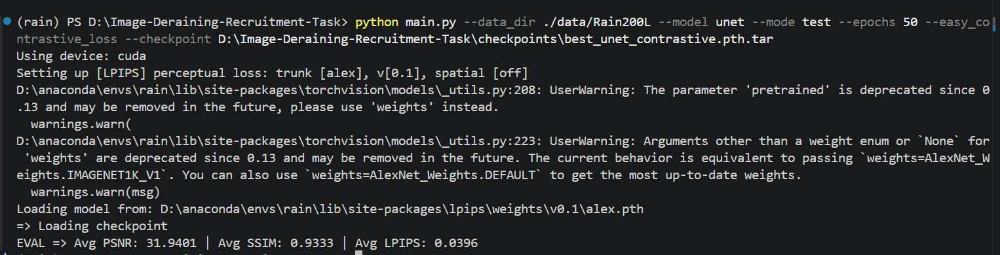

# Part2 - 第二部分

## 基于像素到底有什么不好

1.因为在训练过程中模型找到了两张图之间的特征关系，比较的对象变成了特征。

2.预训练模型在这里用来提取图像特征，为处理的图像提供标准。

3.1.

```python
import torch
import torch.nn as nn
from torchvision.models import vgg19, VGG19_Weights


class PerceptualLoss(nn.Module):
    def __init__(self):
        super(PerceptualLoss, self).__init__()
        vgg = vgg19(weights=VGG19_Weights.DEFAULT).features
        for param in vgg.parameters():
            param.requires_grad = False
        self.layers = nn.Sequential(*(list(vgg)[:35])).eval()

        self.loss = nn.L1Loss()
    def forward(self, generated, ground_truth):
        feature1 = self.layers(generated)
        feature2 = self.layers(ground_truth)

        Loss = self.loss(feature1,feature2) 
        return Loss
```


2.训练结果

测试结果



------

## 你知道什么是向量吗？

1.**向量**是一组有序的数字列表，**维度**就是描述一个东西需要用到的向量由几个数字组成。

2.设 \(\vec{a}=(a_1,a_2,\dots,a_n)\)，\(\vec{b}=(b_1,b_2,\dots,b_n)\)。

代数形式：$\vec{a}\cdot\vec{b}
= a_1b_1+a_2b_2+\cdots+a_nb_n
= \sum_{i=1}^{n}a_i b_i$

几何形式：$\vec{a}\cdot\vec{b}
= |\vec{a}|\,|\vec{b}|\cos\theta$

向量内积为线性代数定义了正交、投影等概念。矩阵乘法的本质也是向量的内积。

3.向量内积可以用来判断两个向量的夹角，计算投影的长度，做卷积，衡量相似度等。**余弦相似度**就是两个向量夹角的余弦值，衡量的是**方向相似程度**，不关心长度。

------

## 改造感知损失函数，使用特征做对比

2.1.AdaptiveAvgPool2d用法例：

```python
pool = nn.AdaptiveAvgPool2d((1,1))
```

`(1,1)`表示将H，W压缩成1,1

去除多余的维度，只留下（B，C）

```python
feat_vector = feat_pooled.flatten(1)
```

`flatten(1)`表示从第一维开始展平

可以使用` nn.CosineSimilarity(dim=1)`来计算余弦相似度

训练结果



测试结果


