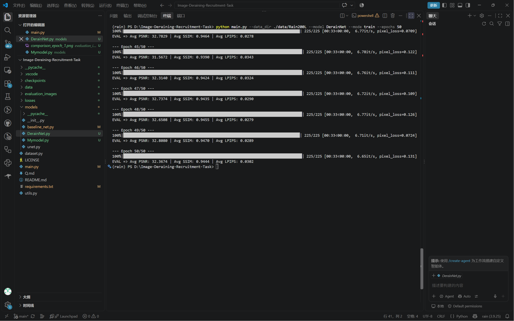

# part2 - 第一部分 任务二

2.

3.**下采样**就是把图片的尺寸减少,可以通过池化操作来进行，**上采样**就是把图片的尺寸增加，常用插值法和转置卷积。下面是一个使用插值法的例子：

```python
up = F.interpolate(out, size=(H, W), mode='bilinear', align_corners=False)
```

`interpolate`是pytorch中专门用来缩放特征图尺寸的插值函数，`size=()`中输入H和W

`mode='bilinear'`是双线性插值，根据周围4个像素加权平均算出新像素

`align_corners=False`避免边缘像素扭曲

**concat**指的是将多个张量拼接在一起成为一个大张量，必须满足**除拼接维度外，其他所有维度必须完全一致**，以下是一个示例：

```python
concat = torch.cat([up_1, up_2, up_3], dim=1)
```

`dim`表示沿哪个维度，[0,1,2,3]对应[B,C,H,W]

## 多层网络写法

2.以下是一个示例：

```python
class SimpleDynamicNet(nn.Module):
    def __init__(self, in_channels=3, out_channels=16, num_layers=3):
        super().__init__()
        
        # 1. 创建一个空列表，用来装每一层
        layers = []
        
        # 2. 循环 num_layers 次，每次造一层卷积 + BN + ReLU
        for i in range(num_layers):
            # 如果是第一层，输入通道用 in_channels；后面的层输入通道都用 out_channels
            current_in = in_channels if i == 0 else out_channels
            
            layers.append(nn.Conv2d(current_in, out_channels, kernel_size=3, padding=1))
            layers.append(nn.BatchNorm2d(out_channels))
            layers.append(nn.ReLU(inplace=True))
        
        # 3. 把列表解包，打包成一个整体，注册到网络里
        self.body = nn.Sequential(*layers)
        
        # 4. 最后加一个输出层，把通道数变回 3
        self.out_conv = nn.Conv2d(out_channels, 3, kernel_size=3, padding=1)

```


`layers = []`准备一个空列表，存放动态生成的层

`for i in range(n)`循环n次

`current_in = in_channels if i == 0 else out_channels`

第一层接受in_channels通道的图片，其余层接受out_channels通道的层

`layers.append(nn.Conv2d(current_in, out_channels, kernel_size=3, padding=1))`

`layers.append(nn.BatchNorm2d(out_channels)`

`layers.append(nn.ReLU()`

append的意思是追加到列表末尾

`self.body = nn.Sequential(*layers)`*layers是python的解包写法，把列表中的层拆出来

`nn.Sequential(...)`接受拆出来的层，按顺序打包


